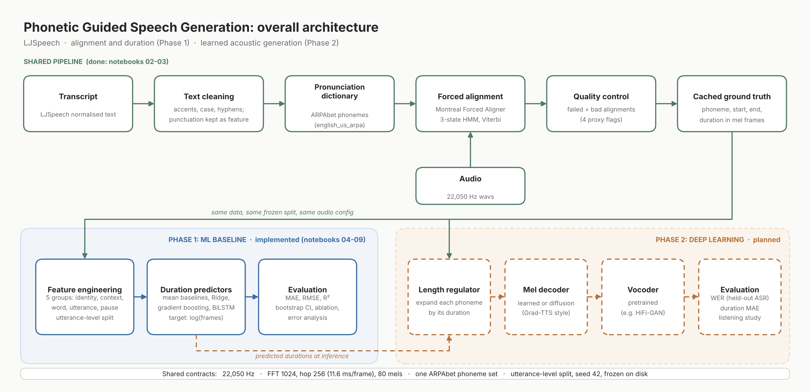

# Phonetic Guided Speech Generation

📄 **Phase 1 Report:** [Read on Google Drive](https://drive.google.com/file/d/11P44rLZVEg6oT8ZBih7f50UpChBnJ-3z/view)  
🎧 **Live Demo:** see [README_DEMO.md](README_DEMO.md) for Colab, local, and Hugging Face Space instructions

**Phoneme alignment, duration modelling and duration-controlled speech synthesis for text-to-speech, built on LJSpeech.**

Advanced ML / Deep Learning course project (Rishihood University). The project compares **explicit phoneme-duration alignment** with a **learned acoustic generator**, delivered in two phases.

| | Phase 1: ML Baseline | Phase 2: Deep Learning |
|---|---|---|
| Question | How accurately can phoneme durations be obtained and predicted from text? | Does a learned acoustic model fix what duration-only synthesis lacks? |
| Status | ✅ **Complete** (notebooks 01–08, IEEE report) | ✅ **Complete** (notebooks 10–17, report extension, Gradio demo) |
| Output | Aligned dataset, duration predictors (best BiLSTM MAE **1.33 frames / 15.4 ms**), metrics, [IEEE report](https://drive.google.com/file/d/18pxGjFboRaed_xukYO8-U8Kns3fKvJRJ/view) | FastSpeech 2-style mel decoder, HiFi-GAN vocoder, duration-swap experiment, Gradio demo app |

---

## Table of Contents

1. [Why This Project](#why-this-project)
2. [Architecture](#architecture)
3. [Phase 1 — ML Baseline](#phase-1--ml-baseline)
4. [Phase 2 — Duration-Controlled Speech Synthesis](#phase-2--duration-controlled-speech-synthesis)
5. [Notebook Flow](#notebook-flow)
6. [Repository Layout](#repository-layout)
7. [Quick Start](#quick-start)
8. [Evaluation Protocol](#evaluation-protocol)
9. [Results](#results)
10. [Design Decisions](#design-decisions)
11. [Reproducibility](#reproducibility)
12. [Limitations](#limitations)
13. [Team and Contributions](#team-and-contributions)
14. [References](#references)

---

## Why This Project

A TTS system must know **when** each phoneme occurs and **how long** it lasts. Alignment says *when*; it does not create natural timbre, coarticulation or prosody. This repo builds the alignment/duration foundation (Phase 1) and plugs in a learned acoustic generator (Phase 2), so both approaches can be compared on identical data and splits.

## Architecture



**The cached alignments are the contract between the phases:** Phase 1 uses them as regression targets; Phase 2 uses them as conditioning for the acoustic model. Both share one audio configuration, one phoneme inventory and one frozen split.

### Shared Contracts (do not change after alignments are cached)

| Contract | Where | Value |
|---|---|---|
| Audio | `configs/data.yaml` | 22,050 Hz, FFT 1024, hop 256 (11.6 ms/frame), 80 mels, 0–8 kHz |
| Phoneme set | `src/features/phones.py` | 39 ARPAbet phones + `sil`, `spn`, stress digits |
| Splits | `data/splits/{train,val,test}_ids.txt` | by utterance, seed 42, 90/5/5 |
| Duration unit | everywhere | mel frames of hop 256 |

---

## Phase 1 — ML Baseline

Phase 1 asks: **how accurately can phoneme durations be predicted from text alone?**

### Pipeline

1. **Text preparation** — accents stripped, lowercased, hyphens split, punctuation removed for alignment but kept as a per-word side-channel feature.
2. **Forced alignment** — MFA with the pretrained `english_us_arpa` model (3-state left-to-right HMMs, GMM emissions, Viterbi decoding). Phone boundaries converted from seconds to mel frames with cumulative rounding.
3. **Alignment QA** — detects *bad* alignments, not just failed ones: unknown-word noise (`spn`), abnormal speech rate, many minimum-length phones, abnormal leading/trailing silence. Flags are recorded in `alignment_qa.csv`.
4. **EDA** — duration distributions per phone/class, effects of stress, pauses and word position, and a test of the HMM duration model (geometric vs 3-state negative binomial) against real data.
5. **Feature engineering** — five groups: identity, context, word, utterance, pause/punctuation. Target: duration in frames (models predict `log(frames)`).
6. **Models** — global mean, per-phone mean (AML baseline), back-off table, Ridge, histogram gradient boosting, BiLSTM.
7. **Evaluation** — MAE/RMSE/R² in frames and ms, utterance-level bootstrap confidence intervals, paired significance test, per-phone/class/bin error analysis, feature-group ablation.

### Feature Groups

| Group | Features | Motivation |
|---|---|---|
| Identity | phone, stress, class, is-vowel | intrinsic duration |
| Context | previous/next two phones | coarticulation |
| Word | position and length in word, first/last | word-final lengthening |
| Utterance | word index, relative position, lengths | phrase effects |
| Pause/punct. | pause before/after, punctuation after word | phrase-final lengthening |

### Phase 1 Results

| Model | Test MAE (frames) | 95% CI | Test MAE (ms) | R² |
|---|---|---|---|---|
| Global mean | 3.138 | [3.110, 3.167] | 36.4 | ~0.00 |
| Phone mean (AML baseline) | 2.400 | [2.371, 2.431] | 27.9 | 0.269 |
| Back-off table | 2.220 | [2.193, 2.248] | 25.8 | 0.424 |
| Ridge | 2.013 | [1.987, 2.043] | 23.4 | 0.511 |
| Gradient boosting | 1.540 | [1.517, 1.566] | 17.9 | 0.697 |
| **BiLSTM** | **1.330** | **[1.310, 1.353]** | **15.4** | **0.775** |

The ranking is monotone in model capacity. The BiLSTM beats gradient boosting by 0.21 frames; 95% CIs do not overlap.

### Ablation (Gradient Boosting)

| Dropped group | Δ MAE (frames) |
|---|---|
| Identity | +0.559 |
| Context | +0.402 |
| Pause/punctuation | +0.114 |
| Word | +0.061 |
| Utterance | −0.006 |

Identity features alone reach 2.388 frames — about the phone-mean baseline — so context, pause and word features account for ~0.85 frames of improvement.

---

## Phase 2 — Duration-Controlled Speech Synthesis

Phase 2 asks: **does a learned acoustic model fix what duration-only synthesis lacks?**

### System Overview

The acoustic model follows **FastSpeech 2** (without pitch and energy predictors):

1. **Encoder** — phoneme and stress embeddings with sinusoidal positions pass through 4 feed-forward Transformer (FFT) blocks (2-head self-attention + 1D convolutional feed-forward).
2. **Length regulator** — repeats each token vector by its duration (teacher forcing with ground-truth durations during training).
3. **Decoder** — 4 further FFT blocks produce an 80-bin mel spectrogram.
4. **Duration head** — 2 convolutional layers predicting `log(d+1)`, trained jointly.
5. **Vocoder** — pretrained **HiFi-GAN** (SpeechBrain, trained on LJSpeech); not trained by us.

**Model size:** 8.84 M parameters (hidden size 256).

### Training Details

- **Optimiser:** AdamW, peak LR 5×10⁻⁴, 1,000 warm-up steps, inverse-square-root decay
- **Loss:** masked L₁ on normalised mel + masked MSE on log-duration
- **Batch:** 16, grouped by length, mixed precision, gradient clipping at 1.0
- **Best checkpoint:** step 8,000, validation mel L₁ = 0.407 (normalised units)
- **Copy-synthesis sanity check:** re-synthesising real clips through the mel recipe + HiFi-GAN gave mean log-mel L₁ of 1.30

### Duration-Source Experiment

The same trained model synthesised each test utterance with 5 duration sources. Silence tokens keep ground-truth length in every condition; only speech-phone durations differ. Spectral quality is measured by DTW mel L₁ distance (timing-invariant).

| Duration Source | DTW Mel L₁ | 95% CI | Total Length Error (frames) |
|---|---|---|---|
| Ground truth (upper bound) | 0.662 | [0.656, 0.667] | 0.0 |
| **Phase 1 BiLSTM** | **0.665** | **[0.659, 0.670]** | **20.1** |
| Own duration head | 0.666 | [0.661, 0.671] | 19.9 |
| Phone mean | 0.678 | [0.673, 0.684] | 48.5 |
| Global mean | 0.686 | [0.681, 0.691] | 42.2 |

### Paired Bootstrap Comparisons

| Comparison | Mean Δ DTW | 95% CI | % Utterances A Better |
|---|---|---|---|
| BiLSTM − phone mean | −0.0136 | [−0.0155, −0.0116] | 89.5% |
| BiLSTM − global mean | −0.0213 | [−0.0243, −0.0185] | 92.0% |
| BiLSTM − own head | −0.0015 | [−0.0023, −0.0005] | 57.0% |
| BiLSTM − ground truth | +0.0029 | [+0.0015, +0.0043] | 37.5% |

**Key findings:**
- The Phase 1 BiLSTM durations close **82%** of the gap between phone-mean baseline and ground-truth durations.
- Total-length error drops from 48.5 frames (phone mean) to 20.1 frames (BiLSTM).
- The absolute effect is small (2.0% of the phone-mean distance): most remaining distance is from the acoustic model itself, not timing.

### Gradio Demo App

A **Gradio** web app lets users type text and hear the synthesised speech. See [README_DEMO.md](README_DEMO.md) for:
- Running in **Colab** (notebook 17)
- Running **locally** (`python app.py`)
- Deploying to **Hugging Face Spaces**

---

## Notebook Flow

Run in order. Notebooks are written for Google Colab with the project folder on Drive.

### Phase 1 Notebooks (01–08)

| # | Notebook | Purpose | Reads | Writes |
|---|---|---|---|---|
| 01 | `01_dataset_overview` | Metadata, durations, audio properties, listening, alignment-risk scan | LJSpeech | `results/01_*`, `processed/metadata_with_stats.csv` |
| 02 | `02_text_and_phoneme_prep` | Text cleaning, punctuation codes, MFA corpora, phoneme inventory | metadata | `processed/transcripts_clean.csv`, `src/features/phones.py` |
| 03 | `03_alignment_run_and_qa` | Install MFA, OOV check, align, parse, QA flags, spot checks | MFA corpora | `alignments/phone_durations.csv.gz`, `failed_utterances.csv`, `alignment_qa.csv` |
| 04 | `04_duration_eda` | Duration statistics, context effects, HMM-vs-data test | alignments, QA | `results/04_*` |
| 05 | `05_feature_engineering` | Feature table, frozen utterance-level split | alignments, QA, transcripts | `processed/features.csv.gz`, `data/splits/*` |
| 06 | `06_baseline_models` | Baselines, Ridge, gradient boosting, permutation importance | features | `results/06_*`, `results/preds_*.csv` |
| 07 | `07_neural_duration_model` | BiLSTM duration predictor (GPU) | features | `results/07_*`, `preds_bilstm.csv`, checkpoint |
| 08 | `08_evaluation_and_error_analysis` | Test table with CIs, significance, error analysis, ablation | preds, features | `results/08_*` |

### Phase 2 Notebooks (10–17)

| # | Notebook | Purpose | Reads | Writes |
|---|---|---|---|---|
| 10 | `10_mel_extraction_and_contract` | Extract mels, validate contract (audio config, phone set, splits) | raw audio, alignments | `processed/phase2_contract.json`, `mel_stats.json`, mel cache |
| 11 | `11_acoustic_model` | Define FastSpeech 2-style encoder–decoder and duration head | — | model code |
| 12 | `12_train_acoustic_model` | Train acoustic model (GPU), log curves, save best checkpoint | mels, durations | `checkpoints/acoustic/best.pt`, `results/12_*` |
| 13 | `13_vocoder` | Load pretrained HiFi-GAN, run copy-synthesis sanity check | mels | `results/13_copy_synthesis.csv` |
| 14 | `14_evaluation_duration_swap` | Duration-source experiment: DTW mel distance, paired bootstrap, listening test prep | checkpoint, mels, Phase 1 preds | `results/14_*` |
| 15 | `15_demo_and_summary` | Generate Phase 2 summary, export results | `results/` | `results/15_phase2_summary.md` |
| 16 | `16_final_report_generation` | Generate report macros, figures, tables for Overleaf | `results/` | `reports/figures/*`, `reports/tables/phase2_*`, `reports/results_macros_phase2.tex` |
| 17 | `17_demo_app` | Launch Gradio demo app (Colab with public link) | checkpoint, processed data | live demo |

Each notebook starts with the same setup cell, states its goal, and ends with viva-style check questions.

---

## Repository Layout

```
.
├── README.md                    # this file
├── README_DEMO.md               # demo app instructions
├── CONTRIBUTIONS.md             # per-member contribution table
├── architecture.png             # system architecture diagram
├── app.py                       # standalone Gradio launcher
├── requirements.txt             # full dependencies
├── requirements_demo.txt        # demo-only dependencies
│
├── configs/
│   └── data.yaml                # shared audio config, paths, split params
│
├── data/                        # NOT committed
│   ├── raw/                     # LJSpeech-1.1
│   ├── processed/               # cleaned transcripts, features, mel cache, contract files
│   ├── alignments/              # phone_durations.csv.gz, alignment_qa.csv
│   └── splits/                  # train/val/test_ids.txt (frozen)
│
├── notebooks/                   # 01–08 (Phase 1), 10–17 (Phase 2)
│
├── src/
│   ├── alignment/               # TextGrid parser
│   ├── data/                    # dataset / dataloader utilities
│   ├── evaluation/              # metrics (MAE, RMSE, R², bootstrap)
│   ├── features/                # phoneme inventory, feature-set definitions
│   ├── models/
│   │   ├── duration/            # BiLSTM duration predictor
│   │   └── acoustic/            # FastSpeech 2-style encoder–decoder
│   ├── training/                # training loops
│   └── utils/                   # config loader
│
├── vocoder/
│   ├── __init__.py
│   └── hifigan.py               # HiFi-GAN wrapper
│
├── results/                     # tables, figures, predictions, checkpoints (generated)
│   ├── 01_*                     # dataset overview outputs
│   ├── 04_*                     # EDA outputs
│   ├── 06_*, 07_*, 08_*         # Phase 1 model outputs
│   ├── 10_*                     # mel contract outputs
│   ├── 12_*                     # training curves
│   ├── 13_*                     # copy-synthesis results
│   ├── 14_*                     # duration-swap experiment results
│   ├── 15_*                     # Phase 2 summary
│   ├── preds_*.csv              # per-model predictions
│   └── duration_bilstm.pt       # BiLSTM checkpoint
│
├── reports/                     # IEEE-format LaTeX report
│   ├── main.tex                 # Phase 1 report body
│   ├── phase2_section.tex       # Phase 2 report section
│   ├── phase2_conclusion.tex    # updated conclusion
│   ├── phase2_references.tex    # additional references
│   ├── results_macros_phase2.tex # auto-generated Phase 2 numbers
│   ├── PHASE2_PATCH.md          # instructions to integrate Phase 2 into Overleaf
│   ├── phase2_overleaf_bundle.zip
│   ├── figures/                 # report-quality figures (both phases)
│   └── tables/                  # LaTeX table fragments
│
├── shera/                       # working copies of notebooks (Shera's branch)
├── scripts/                     # utility scripts
└── tests/                       # unit tests
```

---

## Quick Start

### Prerequisites

- A Google account (Colab + Drive), ~10 GB Drive space
- GPU runtime for notebooks 07 and 12 (T4 is enough)

### Phase 1

1. Clone this repo (or copy it) to `MyDrive/phonetic-tts`.
2. Download LJSpeech 1.1 from <https://keithito.com/LJ-Speech-Dataset/> and place `LJSpeech-1.1.tar.bz2` in `data/raw/`. The dataset is not included in this repo.
3. Open the notebooks in Colab and run **01 → 08 in order**. Re-run each notebook's first cells after a runtime restart (the local `/content` disk is wiped).
4. Notebook 03 installs conda and restarts the runtime once; continue from its *Part B*. Full alignment takes roughly 30–90 minutes on a free CPU runtime; test on the 200-clip corpus first and back up the TextGrids to Drive.

### Phase 2

5. Continue with notebooks **10 → 17 in order** (same Colab + Drive setup).
6. Notebook 12 trains the acoustic model on GPU (~30 min on a T4).
7. Notebook 13 downloads the pretrained HiFi-GAN vocoder automatically.
8. Notebook 17 launches the Gradio demo with a public link.

### Report

9. Upload `reports/` to Overleaf, follow `PHASE2_PATCH.md` to integrate Phase 2 sections, compile `main.tex`.

---

## Evaluation Protocol

### Phase 1 — Duration Prediction

- **Split:** by utterance (never by phone) over all 13,100 ids, frozen on disk; alignment exclusions applied afterwards so the test set never moves.
- **Tuning:** validation only; the test set is scored once.
- **Metrics:** MAE (primary), RMSE, R²; frames and ms. Predictions are `exp(log-prediction)`, targeting the conditional median (MAE-optimal).
- **Uncertainty:** 1,000 bootstrap resamples of utterances for 95% CIs; paired bootstrap for the gain over the baseline.
- **Ablation:** drop one feature group at a time and retrain.

### Phase 2 — Speech Synthesis Quality

- **Same frozen splits** as Phase 1; 200 test utterances evaluated.
- **Duration-source ablation:** same trained acoustic model, 5 duration sources (ground truth, BiLSTM, phone mean, global mean, own head).
- **Metric:** DTW mel L₁ distance (timing-invariant spectral similarity) + absolute total-length error.
- **Uncertainty:** 95% bootstrap CIs over utterances; paired bootstrap differences for all condition pairs.
- **Subjective:** a blind listening test was prepared (notebook 14) but did not pass quality checks; subjective evaluation remains future work.

---

## Results

### Dataset Facts (Notebook 01)

| Item | Value |
|---|---|
| Clips | 13,100 (all 22,050 Hz) |
| Total duration | 23.92 h (min 1.11 s, mean 6.57 s, max 10.10 s) |
| Vocabulary | 14,775 words (6,089 appear once) |
| Raw ≠ normalised text | 1,505 rows |
| Digits in normalised text | 0 |

### Phase 1 — Duration Prediction (Notebook 08)

| Model | Test MAE (frames) | 95% CI | Test MAE (ms) | R² |
|---|---|---|---|---|
| Global mean | 3.138 | [3.110, 3.167] | 36.4 | ~0.00 |
| Phone mean (AML baseline) | 2.400 | [2.371, 2.431] | 27.9 | 0.269 |
| Back-off table | 2.220 | [2.193, 2.248] | 25.8 | 0.424 |
| Ridge | 2.013 | [1.987, 2.043] | 23.4 | 0.511 |
| Gradient boosting | 1.540 | [1.517, 1.566] | 17.9 | 0.697 |
| **BiLSTM** | **1.330** | **[1.310, 1.353]** | **15.4** | **0.775** |

BiLSTM improvement over phone-mean baseline: **1.07 frames** (paired 95% CI significant, no overlap).

### Phase 2 — Synthesis Quality (Notebook 14)

| Duration Source | DTW Mel L₁ ↓ | 95% CI | Length Error (frames) ↓ |
|---|---|---|---|
| Ground truth | 0.662 | [0.656, 0.667] | 0.0 |
| **BiLSTM** | **0.665** | **[0.659, 0.670]** | **20.1** |
| Own head | 0.666 | [0.661, 0.671] | 19.9 |
| Phone mean | 0.678 | [0.673, 0.684] | 48.5 |
| Global mean | 0.686 | [0.681, 0.691] | 42.2 |

BiLSTM durations close **82%** of the gap between phone-mean and ground-truth. The absolute DTW effect is 2.0% — most remaining distance is from the acoustic model, not timing.

---

## Design Decisions

| Decision | Reason |
|---|---|
| Predict `log(duration)` | Durations are right-skewed; log is near-symmetric; matches FastSpeech-style predictors |
| Utterance-level split | Phones in one sentence are correlated; phone-level splitting leaks |
| Split over all ids, then filter | Stable test set even if alignment exclusions change |
| Keep `sil` rows in alignment table | Phase 2 needs durations to sum to the full mel length |
| One audio config + phoneme file | Prevents silent train/inference mismatches between phases |
| Flags, not deletions, in QA | Exclusion is a recorded decision, reproducible and auditable |
| Notebooks for results, `src/` for logic | Readable narrative with testable, reusable code |
| FastSpeech 2 without pitch/energy | Isolates the duration effect; adding pitch/energy is future work |
| Pretrained vocoder (HiFi-GAN) | Avoids confounding acoustic model quality with vocoder training |
| DTW mel distance for evaluation | Removes timing differences to measure spectral quality given durations |

---

## Reproducibility

- **Seeds:** split 42, models 0. All settings in `configs/`.
- **Phase 1 figures/tables** regenerated by notebook 09 from files in `results/`.
- **Phase 2 figures/tables** regenerated by notebook 16 from files in `results/`.
- Large artefacts (data, alignments, checkpoints, mel cache) are not committed; paths and steps are documented above.
- Record the MFA version (`mfa version`) and GPU in the report.
- **Software:** Python, PyTorch, scikit-learn, SpeechBrain (HiFi-GAN), Gradio (demo).

---

## Limitations

- **Label noise:** targets come from forced alignment, whose boundaries are HMM estimates on a 10 ms grid; predictors cannot beat that label noise.
- **Quantisation:** converting 10 ms alignment frames to 11.6 ms mel frames adds up to half a frame of rounding.
- **Single speaker, English, read speech:** results may not transfer.
- **Excluding flagged utterances** may bias the data toward "easy" speech.
- **Acoustic model is small** (8.84 M params) with no pitch or energy predictors; its own mel error dominates remaining distance, limiting how much better durations can help.
- **DTW mel distance is a proxy:** it removes timing differences, so it measures spectral similarity given durations, not naturalness.
- **Vocoder is pretrained** and not fine-tuned to our acoustic model's output distribution.
- **Listening test** was prepared but did not pass quality checks; subjective evaluation remains future work.
- **Free-text inference** with the Phase 1 BiLSTM requires exposing the Phase 1 feature builder as a function (future work); the demo currently uses the model's own duration head.

---

## Team and Contributions

See [`CONTRIBUTIONS.md`](CONTRIBUTIONS.md). The viva is individual: every member should be able to explain every stage.

| Member | Main Area | Notebooks / Sections |
|---|---|---|
| Shreyash Golhani | Dataset exploration, EDA, theoretical rigor (HMM alignment, duration theory) | Notebooks 01–04; report: Dataset/EDA, Theory |
| Ananya Narang | Feature engineering, theoretical rigor | Notebooks 04–05; report: Feature Engineering |
| Vaageesh Kumar Singh | Model application and rigor | Notebooks 06–08; report: Models, Results |
| Anwesha Adhikari | Model application and rigor | Notebooks 06–08; report: Models, Results |
| Aman Kumar | Report, presentation, literature review, README | Report assembly, Introduction, Discussion, Conclusion |

**Collaboration rules:** work on branches, open pull requests, no direct pushes to `main`, clear notebook outputs before committing, never commit data, checkpoints or tokens.

---

## References

- M. McAuliffe et al., "Montreal Forced Aligner: Trainable text-speech alignment using Kaldi," *Interspeech* 2017.
- V. Popov et al., "Grad-TTS: A diffusion probabilistic model for text-to-speech," *ICML* 2021.
- K. Ito and L. Johnson, "The LJ Speech Dataset," 2017.
<<<<<<< HEAD
- L. R. Rabiner, "A tutorial on hidden Markov models...," Proc. IEEE, 1989.
- A.J.Viterbi, "Error bounds for convolutional codes and an asymptotically optimum decoding algorithm," IEEE Transactions on Information Theory, 1967.
- Y. Ren et al., "FastSpeech" (NeurIPS 2019) and "FastSpeech 2" (ICLR 2021).
- A.Vaswani et al., "Attention is all you need," NeurIPS 2017.
=======
- L. R. Rabiner, "A tutorial on hidden Markov models…," *Proc. IEEE*, 1989.
- A. J. Viterbi, "Error bounds for convolutional codes and an asymptotically optimum decoding algorithm," *IEEE Trans. Inf. Theory*, 1967.
- A. P. Dempster, N. M. Laird, and D. B. Rubin, "Maximum likelihood from incomplete data via the EM algorithm," *J. R. Stat. Soc. B*, 1977.
- Y. Ren et al., "FastSpeech" (*NeurIPS* 2019) and "FastSpeech 2" (*ICLR* 2021).
- J. Kong et al., "HiFi-GAN," *NeurIPS* 2020.
- S. Hochreiter and J. Schmidhuber, "Long short-term memory," *Neural Computation*, 1997.
- J. H. Friedman, "Greedy function approximation: A gradient boosting machine," *Ann. Statist.*, 2001.
- A. Vaswani et al., "Attention is all you need," *NeurIPS* 2017.
- A. E. Hoerl and R. W. Kennard, "Ridge regression," *Technometrics*, 1970.
- D. Povey et al., "The Kaldi speech recognition toolkit," *IEEE ASRU* 2011.
- M. Ravanelli et al., "SpeechBrain: A general-purpose speech toolkit," *arXiv:2106.04624*, 2021.
- H. Sakoe and S. Chiba, "Dynamic programming algorithm optimization for spoken word recognition," *IEEE Trans. Acoust., Speech, Signal Process.*, 1978.
- A. Paszke et al., "PyTorch: An imperative style, high-performance deep learning library," *NeurIPS* 2019.
- F. Pedregosa et al., "Scikit-learn: Machine learning in Python," *JMLR*, 2011.

---
>>>>>>> e70f97e (phase 2 upto vocoder part complete)

## License

Add a `LICENSE` file before submission (code under a licence of the team's choice; LJSpeech is public domain; MFA models and HiFi-GAN have their own licences).
