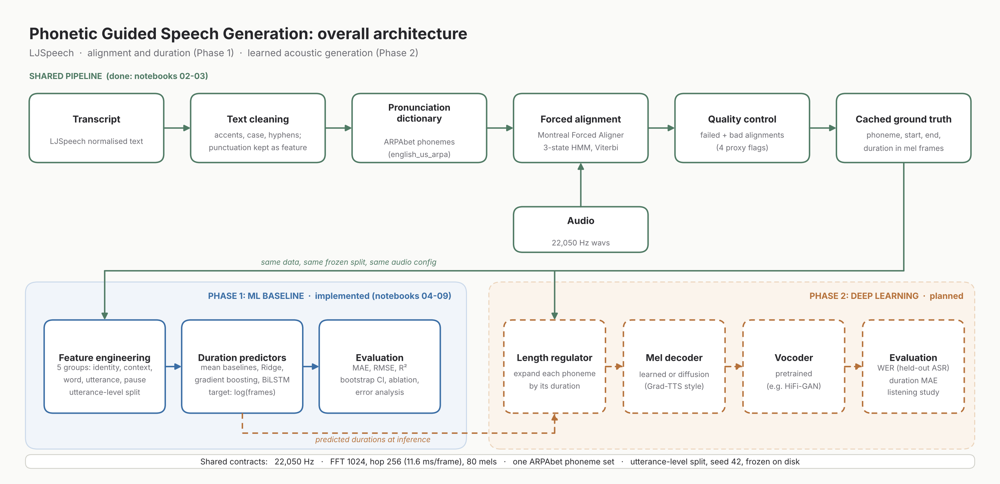

# Phonetic Guided Speech Generation

📄 **Phase 1 Report:** [Read Report on Google Drive](https://drive.google.com/file/d/18pxGjFboRaed_xukYO8-U8Kns3fKvJRJ/view)

**Phoneme alignment and duration modelling for text-to-speech, built on LJSpeech.**
Advanced ML / Deep Learning course project (Rishihood University). The project compares **explicit phoneme-duration alignment** with a **learned acoustic generator** (diffusion extension), and is delivered in two phases.

| | Phase 1: ML baseline | Phase 2: Deep learning |
|---|---|---|
| Question | How accurately can phoneme durations be obtained and predicted from text? | Does a learned acoustic model fix what duration-only synthesis lacks? |
| Status | **Implemented** (notebooks 00-09, report) | **Planned** (interfaces and assets prepared) |
| Output | Aligned dataset, duration predictors, metrics, [IEEE report](https://drive.google.com/file/d/18pxGjFboRaed_xukYO8-U8Kns3fKvJRJ/view) | Mel decoder (+ optional diffusion), vocoder, audio demo, WER, listening study |

---

## Table of contents
1. [Why this project](#why-this-project)
2. [Architecture](#architecture)
3. [Phase 1 in detail](#phase-1-in-detail)
4. [Phase 2 plan](#phase-2-plan)
5. [Notebook flow](#notebook-flow)
6. [Repository layout](#repository-layout)
7. [Quick start](#quick-start)
8. [Evaluation protocol](#evaluation-protocol)
9. [Results](#results)
10. [Design decisions](#design-decisions)
11. [Reproducibility](#reproducibility)
12. [Limitations](#limitations)
13. [Team and contributions](#team-and-contributions)
14. [References](#references)

---

## Why this project
A TTS system must know **when** each phoneme occurs and **how long** it lasts. Alignment says *when*; it does not create natural timbre, coarticulation or prosody. This repo builds the alignment/duration foundation (Phase 1) and the interfaces needed to plug in a learned acoustic generator (Phase 2), so both approaches can be compared on identical data and splits.

## Architecture



**The cached alignments are the contract between the phases:** Phase 1 uses them as regression targets, Phase 2 as conditioning for the acoustic model. Both share one audio configuration, one phoneme inventory and one frozen split.

### Shared contracts (do not change after alignments are cached)
| Contract | Where | Value |
|---|---|---|
| Audio | `configs/data.yaml` | 22,050 Hz, FFT 1024, hop 256 (11.6 ms/frame), 80 mels, 0-8 kHz |
| Phoneme set | `src/features/phones.py` | 39 ARPAbet phones + `sil`, `spn`, stress digits |
| Splits | `data/splits/{train,val,test}_ids.txt` | by utterance, seed 42, 90/5/5 |
| Duration unit | everywhere | mel frames of hop 256 |

## Phase 1 in detail
1. **Text preparation** - accents stripped, lowercased, hyphens split, punctuation removed for alignment but kept as a per-word side-channel feature.
2. **Forced alignment** - MFA with the pretrained `english_us_arpa` model (3-state left-to-right HMMs, GMM emissions, Viterbi decoding). Phone boundaries converted from seconds to mel frames with cumulative rounding.
3. **Alignment QA** - detects *bad* alignments, not just failed ones: unknown-word noise (`spn`), abnormal speech rate, many minimum-length phones, abnormal leading/trailing silence. Flags are recorded in `alignment_qa.csv`.
4. **EDA** - duration distributions per phone/class, effects of stress, pauses and word position, and a test of the HMM duration model (geometric vs 3-state negative binomial) against real data.
5. **Feature engineering** - five groups: identity, context, word, utterance, pause/punctuation. Target: duration in frames (models predict `log(frames)`).
6. **Models** - global mean, per-phone mean (AML baseline), back-off table, Ridge, histogram gradient boosting, BiLSTM.
7. **Evaluation** - MAE/RMSE/R2 in frames and ms, utterance-level bootstrap confidence intervals, paired significance test, per-phone/class/bin error analysis, feature-group ablation.

## Phase 2 plan
*(Not implemented yet; listed so the current design can be audited against it.)*
- **Length regulator**: expand phoneme encodings to frame length using true (training) or predicted (inference) durations.
- **Acoustic generator**: fine-tune a small pretrained TTS model or train a mel decoder conditioned on phonemes and durations; diffusion (Grad-TTS style) as an optional extension once a baseline works.
- **Vocoder**: pretrained (e.g. HiFi-GAN) - mel settings above are chosen to match common checkpoints; verify against the chosen checkpoint before training.
- **Evaluation**: WER from a held-out ASR model, duration MAE, and a small human intelligibility preference study, always on the same test split; document intelligibility failures.
- **Reserved code**: `src/models/acoustic/`, `configs/phase2_*.yaml`.

## Notebook flow
Run in order. Notebooks are written for Google Colab with the project folder on Drive.

| # | Notebook | Purpose | Reads | Writes |
|---|---|---|---|---|
| 01 | `01_dataset_overview` | Metadata, durations, audio properties, listening, alignment-risk scan | LJSpeech | `results/01_*`, `processed/metadata_with_stats.csv` |
| 02 | `02_text_and_phoneme_prep` | Text cleaning, punctuation codes, MFA corpora, phoneme inventory | metadata | `processed/transcripts_clean.csv`, `src/features/phones.py` |
| 03 | `03_alignment_run_and_qa` | Install MFA, OOV check, align, parse, QA flags, spot checks | MFA corpora | `alignments/phone_durations.csv.gz`, `failed_utterances.csv`, `alignment_qa.csv` |
| 04 | `04_duration_eda` | Duration statistics, context effects, HMM-vs-data test | alignments, QA | `results/04_*` |
| 05 | `05_feature_engineering` | Feature table, frozen utterance-level split | alignments, QA, transcripts | `processed/features.csv.gz`, `data/splits/*` |
| 06 | `06_baseline_models` | Baselines, Ridge, gradient boosting, permutation importance | features | `results/06_*`, `results/preds_*.csv` |
| 07 | `07_neural_duration_model` | BiLSTM duration predictor (GPU) | features | `results/07_*`, `preds_bilstm.csv`, checkpoint |
| 08 | `08_evaluation_and_error_analysis` | Test table with CIs, significance, error analysis, ablation | preds, features | `results/08_*` |
| 09 | `09_figures_for_report` | Report figures and LaTeX tables from saved results | `results/` | `reports/figures`, `reports/tables` |

Each notebook starts with the same setup cell, states its goal, and ends with viva-style check questions.

## Repository layout
```
.
├── README.md
├── requirements.txt
├── configs/            # data.yaml (shared audio, paths, split)
├── data/               # NOT committed: raw/, processed/, alignments/, splits/
├── notebooks/          # 01-09 (00 is the setup notebook)
├── src/
│   ├── utils/          # config loader
│   ├── alignment/      # TextGrid parser
│   ├── features/       # phoneme inventory, feature-set definitions
│   ├── evaluation/     # metrics
│   ├── models/{duration,acoustic}/   # acoustic reserved for Phase 2
│   └── training/
├── results/            # tables, figures, predictions (generated)
├── reports/            # main.tex, results_macros.tex, figures/, tables/
├── scripts/  tests/
└── CONTRIBUTIONS.md
```

## Quick start
**Prerequisites:** a Google account (Colab + Drive), about 10 GB of Drive space, a GPU runtime for notebook 07 (T4 is enough).

1. Clone this repo (or copy it) to `MyDrive/phonetic-tts`.
2. Download LJSpeech 1.1 from <https://keithito.com/LJ-Speech-Dataset/> and place `LJSpeech-1.1.tar.bz2` in `data/raw/`. The dataset is not included in this repo.
3. Open the notebooks in Colab and run **00 -> 09 in order**. Re-run each notebook's first cells after a runtime restart (the local `/content` disk is wiped).
4. Notebook 03 installs conda and restarts the runtime once; continue from its *Part B*. Full alignment takes roughly 30-90 minutes on a free CPU runtime; test on the 200-clip corpus first and back up the TextGrids to Drive.
5. Build the report: upload `reports/` to Overleaf, fill `results_macros.tex` with your numbers, compile `main.tex`.

## Evaluation protocol
- **Split:** by utterance (never by phone) over all 13,100 ids, frozen on disk; alignment exclusions applied afterwards so the test set never moves.
- **Tuning:** validation only; the test set is scored once.
- **Metrics:** MAE (primary), RMSE, R2; frames and ms. Predictions are `exp(log-prediction)`, which targets the conditional median (MAE-optimal).
- **Uncertainty:** 1,000 bootstrap resamples of utterances for 95% CIs; paired bootstrap for the gain over the baseline.
- **Ablation:** drop one feature group at a time and retrain.

## Results
Dataset facts (notebook 01):

| Item | Value |
|---|---|
| Clips | 13,100 (all 22,050 Hz) |
| Total duration | 23.92 h (min 1.11 s, mean 6.57 s, max 10.10 s) |
| Vocabulary | 14,775 words (6,089 appear once) |
| Raw != normalised text | 1,505 rows |
| Digits in normalised text | 0 |

Model results: **to be filled from `results/08_test_table.csv` after running notebooks 03-08.**

| Model | Test MAE (frames) | 95% CI | Test MAE (ms) | R2 |
|---|---|---|---|---|
| Global mean | _TBD_ | | | |
| Phone mean (AML baseline) | _TBD_ | | | |
| Back-off table | _TBD_ | | | |
| Ridge | _TBD_ | | | |
| Gradient boosting | _TBD_ | | | |
| BiLSTM | _TBD_ | | | |

## Design decisions
| Decision | Reason |
|---|---|
| Predict `log(duration)` | Durations are right-skewed; log is near-symmetric; matches FastSpeech-style predictors |
| Utterance-level split | Phones in one sentence are correlated; phone-level splitting leaks |
| Split over all ids, then filter | Stable test set even if alignment exclusions change |
| Keep `sil` rows in alignment table | Phase 2 needs durations to sum to the full mel length |
| One audio config + phoneme file | Prevents silent train/inference mismatches between phases |
| Flags, not deletions, in QA | Exclusion is a recorded decision, reproducible and auditable |
| Notebooks for results, `src/` for logic | Readable narrative with testable, reusable code |

## Reproducibility
- Seeds: split 42, models 0. All settings in `configs/`.
- Every report figure/table is regenerated by notebook 09 from files in `results/`.
- Large artefacts (data, alignments, checkpoints) are not committed; paths and steps are documented above.
- Record the MFA version (`mfa version`) and GPU in the report.

## Limitations
- Labels come from forced alignment, whose boundaries are HMM estimates on a 10 ms grid; predictors cannot beat that label noise.
- Conversion from 10 ms to 11.6 ms frames adds up to half a frame of rounding.
- Single speaker, English, read speech; results may not transfer.
- Phase 1 produces no audio; intelligibility metrics belong to Phase 2.
- Excluding flagged utterances may bias the data toward "easy" speech.

## Team and contributions
See [`CONTRIBUTIONS.md`](CONTRIBUTIONS.md). The viva is individual: every member should be able to explain every stage.

**Collaboration rules:** work on branches, open pull requests, no direct pushes to `main`, clear notebook outputs before committing, never commit data, checkpoints or tokens.

## References
- M. McAuliffe et al., "Montreal Forced Aligner: Trainable text-speech alignment using Kaldi," Interspeech 2017.
- V. Popov et al., "Grad-TTS: A diffusion probabilistic model for text-to-speech," ICML 2021.
- K. Ito and L. Johnson, "The LJ Speech Dataset," 2017.
- L. R. Rabiner, "A tutorial on hidden Markov models...," Proc. IEEE, 1989.
- A.J.Viterbi, "Error bounds for convolutional codes and an asymptotically optimum decoding algorithm," IEEE Transactions on Information Theory, 1967.
- Y. Ren et al., "FastSpeech" (NeurIPS 2019) and "FastSpeech 2" (ICLR 2021).
- A.Vaswani et al., "Attention is all you need," NeurIPS 2017.

## License
Add a `LICENSE` file before submission (code under a licence of the team's choice; LJSpeech is public domain; MFA models have their own licences).
